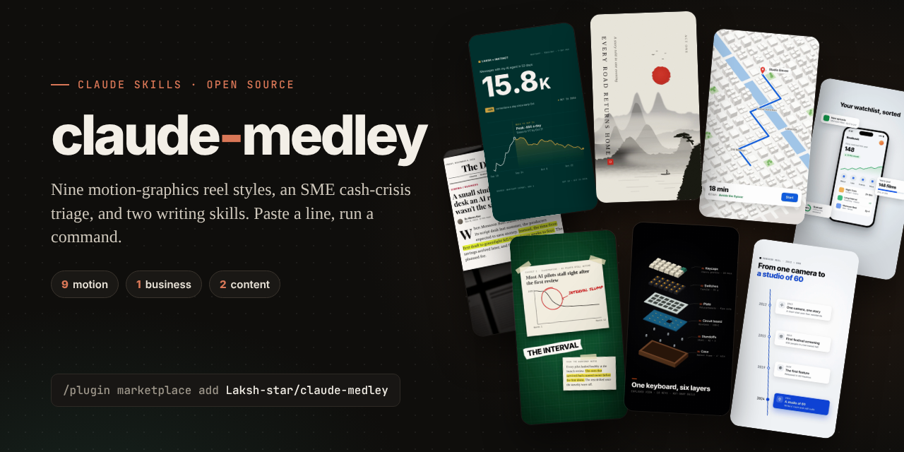
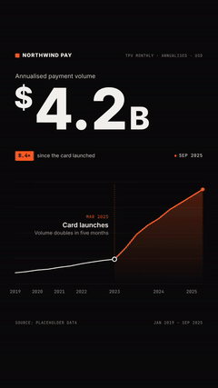
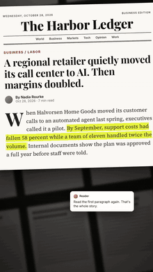
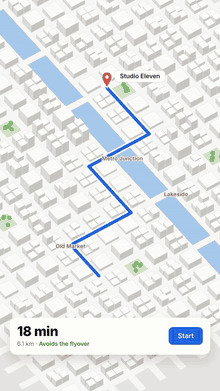
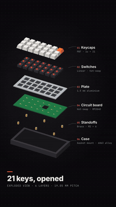
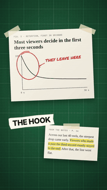
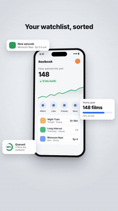
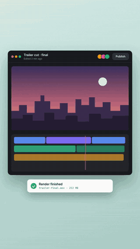
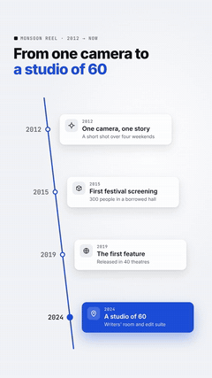

<p align="center">
  
</p>

<p align="center">
  <a href="#install"></a>
  
  <a href="LICENSE"></a>
</p>

<p align="center"><b>A medley of Claude skills: motion graphics, money, and the movies.</b><br>
Paste a line, run a command, get finished work: a vertical reel, a triage plan, or a fact-checked article.</p>

---

## Install

**Claude Code: the whole marketplace, then the bundles you want**

```bash
/plugin marketplace add Laksh-star/claude-medley
/plugin install motion@claude-medley      # 9 reel styles   → /motion:stat-chart, /motion:ink-wash, …
/plugin install business@claude-medley    # CFO Triage Lite → /business:cfo-triage-lite
/plugin install content@claude-medley     # writing skills  → /content:content-dump-to-article, …
```

**Claude apps:** download a single skill from [`dist/`](dist) (e.g. [`stat-chart.zip`](dist/stat-chart.zip)) and upload it under Skills in your Claude settings.

**By hand:** copy any folder from `plugins/<bundle>/skills/` into `~/.claude/skills/`.

---

## 🎬 Motion: nine reel styles

Each skill turns one pasted line into a **720×1280 (9:16) MP4, about 8 seconds long**, rendered on your machine with [HyperFrames](https://github.com/heygen-com/hyperframes) (HTML + GSAP → MP4). No video model, no paid API, no editing software. Claude fills a small config block from your text, checks the composition, renders it, and looks at the frames before handing it over.

<table>
<tr>
<td align="center" width="33%"><br><b><code>stat-chart</code></b><br>Big number counts up, a chart draws itself, one callout marks the turning point. <i>Shown: 52 days of my own AI-agent usage.</i></td>
<td align="center" width="33%"><br><b><code>headline</code></b><br>A newspaper page rises, the camera pushes in, one line gets highlighted.</td>
<td align="center" width="33%"><br><b><code>ink-wash</code></b><br>Ink-painting title card: misty peaks, a red sun, a brush-revealed vertical title.</td>
</tr>
<tr>
<td align="center"><br><b><code>map-route</code></b><br>An isometric city builds, a route draws itself to a pin, an ETA card slides up.</td>
<td align="center"><br><b><code>teardown</code></b><br>Exploded product view: layers lift apart and every part gets a numbered label.</td>
<td align="center"><br><b><code>paper-desk</code></b><br>Evidence on the desk: a chart circled in red marker, a hook label, a highlighted note.</td>
</tr>
<tr>
<td align="center"><br><b><code>phone-mockup</code></b><br>A phone floats in with a live dashboard while UI cards pop out around it.</td>
<td align="center"><br><b><code>ui-walkthrough</code></b><br>A cursor clicks through a product flow, with numbered step captions.</td>
<td align="center"><br><b><code>timeline</code></b><br>A headline, then milestone cards land one by one along a diagonal timeline.</td>
</tr>
</table>

**How you use it**

```text
You:    6.3M monthly watch hours, up from 0.8M since our first original in Jan 2023
        /motion:stat-chart
Claude: (asks for the data points if you haven't given them, fills the config,
         runs `hyperframes check`, renders, checks frames)  →  stat-chart.mp4
```

**What you need:** Node.js, FFmpeg and a Chrome or Chromium install (HyperFrames finds it, or set `HYPERFRAMES_BROWSER_PATH`). Each skill installs GSAP and its fonts from npm at render time, so it also works in sandboxes where CDNs are blocked.

**Rules built into every skill**
- **No invented numbers.** Charts plot only the data you give. An illustrative version is labelled as one.
- **No impersonation.** Mastheads, apps and brands are your own or clearly fictional.
- **No frozen frames.** The animation never relies on update callbacks, which renderers can skip when they jump to a frame. Everything tweens real properties, so every frame renders correctly.

---

## 💼 Business: CFO Triage Lite



Emergency financial triage for SMEs in a cash crunch, a revenue cliff or a margin collapse, using the **5-Fuse** framework from Directing Business Consulting & Advisory. Five questions locate the shortest fuse; each fuse gets a RED / AMBER / GREEN score, followed by **The One Thing** to do this week and a week → month → quarter plan. Indian SME context is built in.

- Command: `/business:cfo-triage-lite`
- Read the framework: [Your business has five fuses. Do you know which one is burning?](https://medium.com/@LakshmiNarayana_U/your-business-has-five-fuses-do-you-know-which-one-is-burning-0d0da7d53048)
- Standalone repo: [Laksh-star/5-fuse-triage](https://github.com/Laksh-star/5-fuse-triage)

This is the free community edition. The full DB Health Score and DB Fiscal Architecture are available through a [Directing Business](https://directingbusiness.in) engagement.

<br clear="right">

---

## ✍️ Content: two writing skills

| Skill | What it does |
|---|---|
| **`content-dump-to-article`** | Turns a raw research dump (notes, NotebookLM exports, transcripts, infographics) into a fact-checked, themed article. It re-researches every claim, keeps a corrections list of what the dump got wrong, and writes an image plan with placements, prompts and alt text. |
| **`cinema-management-framework-extractor`** | Extracts management lessons and frameworks from films, using the method from *Directing Business: Movies and Management Lessons for Dreamers*. Single-film, comparative or thematic analysis; output as a long-form article, a workshop case study, a short-form piece or a framework document. Telugu cinema and classical-literature lenses included. |

Pairs well with Peter Yang's [no-ai-slop](https://github.com/petergyang/no-ai-slop) for a final edit.

---

## What's inside

```text
claude-medley/
├── .claude-plugin/marketplace.json     # the marketplace: three plugins
├── plugins/
│   ├── motion/    skills/  stat-chart · headline · ink-wash · map-route · teardown
│   │                       paper-desk · phone-mockup · ui-walkthrough · timeline
│   ├── business/  skills/  cfo-triage-lite
│   └── content/   skills/  content-dump-to-article · cinema-management-framework-extractor
├── dist/                               # one .zip per skill for the Claude apps
├── assets/                             # banner, previews
└── scripts/package.sh                  # rebuilds dist/
```

Each skill is a self-contained folder with a `SKILL.md`. The motion skills embed their full, tested HTML template, so there is nothing else to fetch.

---

## Credits

- The motion styles were inspired by [@prayag_sonar](https://x.com/prayag_sonar)'s reel of Claude-made animation styles, and six of the command names follow his. All code, sample copy and renders here are original, built from scratch on HyperFrames.
- [HyperFrames](https://github.com/heygen-com/hyperframes) by HeyGen (Apache 2.0) renders the video. [GSAP](https://gsap.com) drives the animation. Fonts are OFL-licensed, via [Fontsource](https://fontsource.org).
- Built with Claude.

## Author

**Lakshmi Narayana**, Founder of [Directing Business Consulting & Advisory](https://directingbusiness.in) and author of *Directing Business: Movies and Management Lessons for Dreamers*. 25+ years bridging technology and entertainment.
[Medium](https://medium.com/@LakshmiNarayana_U) · [X](https://x.com/LakshOnline) · [GitHub](https://github.com/Laksh-star)

Issues and pull requests are welcome, especially new reel styles.

## Licence

[MIT](LICENSE) © 2026 Lakshmi Narayana
